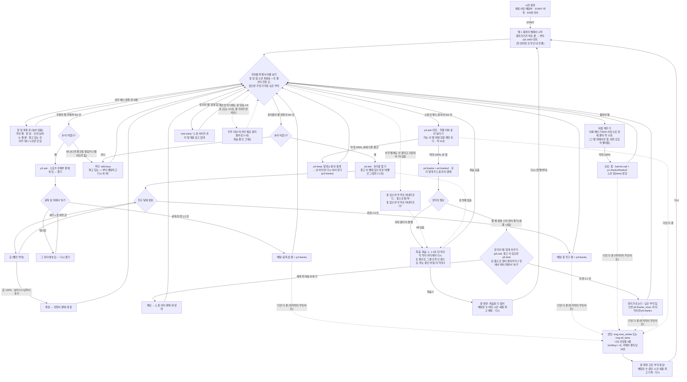

# 어린 배달부 / The Little Courier — 진행 흐름과 글 검토 (옛 기록)

> **지금 글은 `DIALOGUE_FINAL.md`(대사 최종본)와 `g/tinyplanet_text.gd`가 기준이다.** 이 문서의 글은 v8 시절 것이라 '돛'(지금 '구식 날다리')·'노을 아이'(지금 '형님')가 남아 있고, 부탁 순서도 지금은 자유다.

> **2026-10-31 정리됨**: 모든 글이 `g/tinyplanet_text.gd` 한 표(143줄, 키 → [한국어, English])로 옮겨졌다. 아래 표·목록은 그 전 기록이다.
> 영어를 한국어 뜻에 맞춤(1·2·4·5·6·10의 Fire Star·11). 한국어 "초록 칸" → "초록 점선"(3). 안 쓰이던 글 10개 지움(msg.start·liftoff·float·flower_crack·slingshot·rock_snag·picked, banner.intro, howto, "탭해서 시작").
> v9부터 p4·p5 혼잣말과 p5.hint는 실제로 나온다(끝낸 주민 누구나 혼잣말, 덮개 들고 장미 별이면 p5.hint). 평가 카드 글은 모음판에서 쓰여 남겼다. 한국어 고치는 법은 README.md.

코드 기준: `g/tinyplanet.gd`(DL·EN_UI·BD·JOB), `g/tinyplanet_ui.gd`(시작·끝 화면, EN), `g/tinyplanet_fx.gd`(글 없음, EN 비어 있음), `tofu.gd`(공통 바탕 글). 코드는 고치지 않았다.

한국어/영어 고르기: 기본은 영어. 웹 주소에 `lang=ko`가 있거나 시작 화면 오른쪽 아래 "EN | 한국어"에서 고르면 그 말로 나온다.

---

## 1. 게임 진행 플로우차트 (v9 순서 자유)

v9부터 부탁 다섯은 **아무 순서로** 한다. 남은 순서는 하나: 유리 덮개는 노을 띠를 끝내야 생긴다. 물건은 한 번에 하나만 든다. 왼쪽 위 할 일 목록 버튼(끝낸 수 "2/5")을 누르면 언제든 다섯 부탁의 상태를 본다(그동안 놀이가 멈춤).

새 별에 처음 내려앉으면 목숨이 3으로 다시 찬다(+5점). 배달 하나는 +10점. 부탁 하나를 끝내면 "다음: ○○"이 가장 가까운 남은 부탁 별을 알려 준다.

### 같은 흐름, 쉬운 말로

1. 시작 화면: 제목, START 버튼, 오른쪽 아래 EN/한국어.
2. 풍차의 별에서 시작. 풍차지기가 바로 곁이라 곧장 부탁을 말한다. 첫 판이면 "스틱으로 달리기 · 막대가 차면 점프!" 안내가 뒤따른다.
3. 그다음은 **아무 순서로**: 풍차 바람 깨우기(→ 돛), 우체부의 소포(→ 굴뚝 달), 정원사의 유리꽃(→ 친구 달), 노을 아이의 띠 달리기(→ 유리 덮개), 장미에게 덮개 씌우기.
4. 물건은 하나만 든다. 다른 물건을 들고 주민을 만나면 "그것부터 배달하고 다시 와 줘!". 물건이 주인 곁에 놓여 있기만 하면 다른 주민의 물건을 받을 수 있고, 옛 물건은 주인에게 돌아간다.
5. 유리 덮개만은 노을 띠를 끝내야 생긴다. 먼저 장미에게 가면 "노을 아이가 덮개를 갖고 있대". 띠를 끝낼 때 손이 차 있으면 노을 아이가 덮개를 맡아 둔다.
6. 위 할 일 칩과 노란 화살표는 든 물건이 있으면 전할 곳, 없으면 가장 가까운 남은 부탁을 가리킨다(땅에서 다시 고르고, 나는 중에는 안 바뀜). 돛도 스틱을 안 밀면 거기로 튼다.
7. 왼쪽 위 할 일 목록 버튼("2/5")을 누르면 다섯 부탁의 상태(안 만남·하는 중·끝)와 들고 있는 것이 뜬다. 그동안 놀이는 멈추고, 아무 데나 누르면 닫힌다.
8. 소포는 굴뚝 위에서 '놓기', 유리꽃은 친구 달에 살살, 덮개는 불 별 새총으로 장미 별에 가서 담 틈이나 탑으로.
9. 다섯 부탁을 다 끝내면(마지막이 무엇이든) 혼잣말 네 줄 뒤 "모든 부탁 완료!" 끝 화면.
- 옆길: 너무 멀리 떠내려가면 경고 후 죽음(돛을 받기 전엔 돛 말 없음) / 어디에도 못 닿으면 "우주 미아"로 마지막 별에 끌려 돌아감(벌 없음) / 죽으면 목숨 -1, 든 물건은 주인 곁으로, 0이 되면 "목숨을 다 썼어" 끝 화면 / "다시"를 누르면 첫 별부터.

### v9에 더한 글

| 키 | 언제 나오나 | 누가 | 한국어 | English |
|---|---|---|---|---|
| talk.busy | 다른 물건이 나와 있는데 물건 주는 주민을 만남 (30초에 한 번) | 그 주민 | 들고 있는 {item}부터 배달하고 다시 와 줘! | Deliver the {item} you're carrying first, then come back! |
| rose.early | 노을 띠를 끝내기 전에 장미를 만남 (30초에 한 번) | 장미 | 바람이 차가워… 노을 아이가 유리 덮개를 갖고 있대. 노을의 별에 가 봐. | It's cold... The Sunset Child has a glass dome. Try Sunset Planet. |
| p4.keep | 띠를 끝냈는데 손에 다른 물건 | 노을 아이 | 고마워! 유리 덮개는 내가 맡아 둘게. 손이 비면 받으러 와! | Thank you! I'll keep the glass dome here. Come back when your hands are free! |
| p5.thanks_more | 장미 배달인데 남은 부탁이 있음 | 장미 | …따뜻해. 고마워. 다른 별들도 네 빠른 발을 기다리고 있어. | ...Warm now. Thank you. The other planets are waiting for your fast feet too. |
| msg.all_done | 마지막 부탁이 장미가 아닐 때 엔딩 알림 | - | 모든 부탁을 마쳤다! | Every request is done! |
| msg.drift_warn_ns | 돛을 받기 전 떠내려감 경고 | - | 우주로 떠내려간다! | Drifting away! |
| react.drift_warning_ns | 위 상황 첫 번 | 나 | 멀어진다… 초록 점선에서 뛰자 | Drifting... jump on green dots! |
| todo.p1 ~ todo.p5 | 할 일 목록 판의 할 일 줄 | - | 풍차 깨우기: 땅에 붙어 힘껏 달리기 / 소포를 굴뚝 달 집에 공중에서 놓기 / 유리꽃을 친구 달에 살살 전하기 / 주황 노을 띠와 같은 빠르기로 달리기 / 유리 덮개를 장미에게 씌우기 | Wake the windmill: sprint on the ground / Drop the parcel onto the Chimney Moon house / Carry the glass flower gently to Friend Moon / Run at the orange sunset band's speed / Put the glass dome over the rose |
| todo.p5_wait | 할 일 목록, 노을 띠 전 장미 줄 | - | 유리 덮개가 필요해 (노을 아이가 줌) | Needs a glass dome (from the Sunset Child) |
| (ui) 할 일 | 목록 판 제목 (+ " 2/5") | - | 할 일 | To-do |
| (ui) 아직 안 만남 / 하는 중 / 끝 | 목록 줄 상태 | - | 아직 안 만남 / 하는 중 / 끝 | Not met / In progress / Done |
| (ui) 들고 있는 것 / 빈손 | 목록 아래 줄 | - | 들고 있는 것: ○○ / 빈손 | Carrying: ... / Nothing |
| (ui) 탭하면 닫혀요 | 목록 판 맨 아래 | - | 탭하면 닫혀요 | Tap anywhere to close |

v9에서 바꾼 글(순서를 말하던 것): p2.thanks "잘 도착했대, 고마워! 남은 부탁은 왼쪽 위 할 일 목록에 있어." / "Delivered safely, thank you! The rest is in your to-do list, top left.", p3.thanks "꽃이 무사하대요… 정말 다행이에요. 다른 별에도 기다리는 이가 있을 거예요." / "The flower is safe... thank you! Others out there are waiting for you too." 아래 표의 옛 p2/p3.thanks 줄과 "언제 나오나"의 순서 설명(idle 조건 등)은 v8 기준이다. v9: idle은 부탁을 끝낸 주민 곁에서 60초에 한 번, p5.hint는 덮개를 들고 장미 별에 서 있으면 45초에 한 번.

---

## 2. 모든 텍스트

"누가"가 비어 있으면 말하는 사람 없는 안내다. 말풍선 = 아래쪽 크림 말풍선, 알림 = 화면 가운데 짧은 글(msg), 배너 = 위쪽 띠 글, 칩 = 맨 위 할 일 칸.

### 시작 화면

| 키 | 언제 나오나 | 누가 | 한국어 | English |
|---|---|---|---|---|
| (ui) 어린 배달부 | 시작 화면 제목 (마지막 낱말은 큰 글자, 앞은 리본) | - | 어린 배달부 | The Little Courier |
| (ui) 시작 | 시작 버튼 | - | 시작 | START |
| (ui) EN / 한국어 | 오른쪽 아래 언어 알약 (번역 안 함) | - | EN \| 한국어 | EN \| 한국어 |

### 공통 HUD·버튼

| 키 | 언제 나오나 | 누가 | 한국어 | English |
|---|---|---|---|---|
| ui.jump | 늘 있는 점프 버튼 | - | 점프 | Jump |
| ui.drop | 물건을 들고 있을 때 버튼 | - | 놓기 | Drop |
| ui.sail | 돛이 있고 날고 있고 공중 한 번이 남았을 때 | - | 돛 | Sail |
| hint.first | 첫 판, 풍차지기 부탁 바로 뒤 말풍선 | - | 스틱으로 달리기 · 막대가 차면 점프! | Hold the stick to run · Jump when the bar fills |
| hint.sail | 돛 버튼이 처음 나올 때 한 번 | - | 지금 '돛'을 누를 수 있다 · 연한 점선이 돛을 쓰면 갈 길 | Tap SAIL to steer · the light dots show where it takes you |
| msg.sail | 날다가 돛을 쓸 때 알림 | - | 돛으로 방향을 튼다 | Turning with the sail |
| goal.talk | 칩: 다음 별 주민을 아직 안 만났을 때 (별 1~4) | - | {who}에게 말 걸기 | Talk to the {who} |
| goal.wind | 칩: 풍차 부탁 중 | - | 풍차 깨우기: 땅에 붙어 힘껏 달리기 | Wake the windmill: sprint on the ground |
| goal.pick | 칩: 물건을 받으러 가야 할 때 | - | {planet}에서 {item} 받기 | Pick up the {item} on {planet} |
| goal.deliver | 칩: 물건을 들고(또는 떨어지는 중) 있을 때 | - | {target}에 {item} 배달 | Deliver the {item} to {target} |
| goal.band | 칩: 노을 띠 부탁 중 | - | 노을 띠와 같은 빠르기로 달리기 | Run with the orange sunset band |
| item.pkg | 칩 안 {item} | - | 소포 | parcel |
| item.flower | 칩 안 {item} | - | 유리꽃 | glass flower |
| item.dome | 칩 안 {item} | - | 유리 덮개 | glass dome |
| hud.next_hint | 땅에 있고 갈 곳이 다른 별일 때 (50초에 한 번) | - | 다음: {planet} (노란 빛기둥). 달려 점프! 초록 점선이면 닿아. | Next: {planet} (yellow pillar). Run and jump! Green dots will reach. |
| msg.next | 부탁 하나 끝난 뒤 알림 | - | 다음: {planet} | Next: {planet} |
| (별 이름) | 처음 끌려 들어가는 별 이름(0.8초), 처음 내려앉으면 1.6초 알림 | - | 아래 별 이름 표 | 아래 별 이름 표 |
| who.me | 혼잣말·엔딩 말풍선의 이름 | 나 | 나 | Me |

### 별·주민 이름 (BD 표, DL로 번역)

| 키 | 별 | 한국어 | English | 주민 키 | 한국어 | English |
|---|---|---|---|---|---|---|
| name.windmill | 별 1 | 풍차의 별 | Windmill Planet | who.windmill | 풍차지기 | Windmill Keeper |
| name.post | 별 2 | 우편의 별 | Post Planet | who.post | 우체부 | Mail Carrier |
| name.glass | 별 3 | 유리꽃의 별 | Glass Flower Planet | who.glass | 정원사 | Gardener |
| name.sunset | 별 4 | 노을의 별 | Sunset Planet | who.sunset | 노을 아이 | Sunset Child |
| name.rose | 별 5 | 장미의 별 | Rose Planet | who.rose | 장미 | Rose |
| name.chimney_moon | 달 | 굴뚝 달 | Chimney Moon | who.chimney | 굴뚝 집 | Chimney House |
| name.friend_moon | 달 | 친구 달 | Friend Moon | who.friend | 꽃 친구 | Flower Friend |
| name.fire | 위험 | 불 별 | Fire Star | (없음) | - | - |

### 별 1 풍차의 별

| 키 | 언제 나오나 | 누가 | 한국어 | English |
|---|---|---|---|---|
| p1.ask | 풍차지기 5m 안에 처음 갔을 때 | 풍차지기 | 바람이 멎어 풍차가 잠들었네. 별 둘레를 힘껏 달려 바람을 깨워 주겠나? | The wind died and the mill sleeps. Run hard around to wake my friend? |
| p1.hint | 부탁 바로 뒤, 또 막대 15% 미만이면 40초마다 | 풍차지기 | 뜨기 직전이 제일 센 바람이지. 발이 뜨면 바람이 끊기니 땅에 붙어 달리게나. | Fastest just before liftoff is best. Keep your feet on the ground! |
| p1.thanks | 바람 막대 100% | 풍차지기 | 고마우이, 돛을 받게나. 보라 별이 우편의 별이니 노란 줄을 힘껏 달리게. | Thank you! Take the sail. Purple is Post Planet; run the yellow lane. |
| p1.thanks2 | thanks 뒤 이어서 | 풍차지기 | 초록 칸에서 점프하게. 날다 스틱 밀며 뛰면 돛으로 방향을 한 번 튼다네. | Jump at the green cell! In flight, jump and push stick to turn once. |
| banner.sail | 바람 막대 100% (5초 배너) | - | 풍차지기의 고마움: 돛! 날 때 '돛' 버튼을 한 번 누르면 스틱 쪽으로 방향을 튼다 (스틱 안 밀면 갈 곳 쪽). | The Windmill Keeper's thanks: a SAIL! In the air, tap SAIL once to steer toward your stick (no stick = toward your goal). |
| p1.idle1 | 별 3 부탁부터, 풍차지기 곁에서 60초에 한 번(둘 중 하나) | 풍차지기 | 바람결을 느끼며 달리면 하늘도 그 발소리를 듣는다네. | When you run with the wind, the sky listens to your steps. |
| p1.idle2 | 위와 같음 | 풍차지기 | 서두르지 말게. 별은 언제나 제자리에서 자네를 기다리니. | No need to hurry. The stars always wait patiently in place. |

### 별 2 우편의 별 · 굴뚝 달

| 키 | 언제 나오나 | 누가 | 한국어 | English |
|---|---|---|---|---|
| p2.ask | 우체부 5m 안 (또는 순서 전에 가면 40초마다) | 우체부 | 이 소포, 저 하얀 굴뚝 달 집에 전해 줘! 담이 높아 걸어선 못 들어가. | Take this parcel to Chimney Moon! The walls are too high to walk in. |
| got.pkg | 소포를 주웠을 때 배너 3초 | - | 소포! {target}에 전해 주자 | Parcel! Deliver it to {target} |
| p2.hint | 소포를 들고 있으면 45초마다 | 우체부 | 달은 작아 금방 떠! 굴뚝 위 지날 때 '놓기'. 발밑 노란 점에 떨어져! | The moon lifts fast! Press 'Drop' over chimney onto the yellow dot. |
| msg.wall_high | 굴뚝 달 담에 부딪힘 | - | 담이 높다 — 공중에서 놓기 | High wall — drop from above |
| msg.missed_drop | 놓은 물건이 과녁 밖에 떨어짐 | - | 빗나갔다 — 다시 줍기 | Missed — pick it up again |
| moon.chimney.got | 소포 배달 순간 | 굴뚝 집 | 굴뚝 속으로 소포가 쏙 들어왔어! 따뜻한 온기가 번지네. | The parcel dropped right down the chimney! Cozy warmth spreads inside. |
| p2.thanks | 위 말 뒤 | 우체부 | 잘 도착했대, 고마워! 다음은 초록 유리꽃의 별로 힘차게 날아가 봐. | Delivered safely! Next, fly out to the green Glass Flower Planet. |
| p2.idle1 | 별 4 부탁부터, 우체부 곁에서 60초에 한 번 | 우체부 | 하늘에 띄운 편지는 길을 잃지 않아. 언제나 닿을 곳으로 가지! | Letters sent across the sky never get lost. They always arrive! |
| p2.idle2 | 위와 같음 | 우체부 | 오늘도 우편 가방이 든든하네! 다음 행선지는 어디야? | My mailbag is nice and full today! Where are you flying next? |

### 별 3 유리꽃의 별 · 친구 달

| 키 | 언제 나오나 | 누가 | 한국어 | English |
|---|---|---|---|---|
| p3.ask | 정원사 5m 안 | 정원사 | 유리꽃을 저 민트 친구 달에 전해 줘요… 세게 내려앉으면 깨져 버려요. | Carry the glass flower to Friend Moon... A hard landing will break it. |
| got.flower | 유리꽃을 주웠을 때 배너 | - | 유리꽃! 살살 {target}에 전해 주자 | Glass flower! Carry it gently to {target} |
| p3.hint | 유리꽃을 들고 있으면 45초마다 | 정원사 | 곧장 말고 빙 돌아 살살 앉아요. 빨간 그림자는 운석 자리니 미리 피해요! | Don't dive straight; circle to land softly. Red shadows are meteors! |
| msg.glass_broken | 금 100% 또는 높이 놓기로 깨짐 | - | 깨졌다… {src}에서 다시 받기 | Broken... get another at {src} |
| moon.friend.got | 유리꽃 배달 순간 | 꽃 친구 | 정원사의 맑은 꽃이 깨지지 않고 닿았어… 달이 환해졌네! | The gardener's clear flower arrived unbroken... the moon glows! |
| p3.thanks | 위 말 뒤 | 정원사 | 꽃이 무사하대요… 정말 다행이에요. 이제 하늘색 노을의 별로 가 보세요. | The flower is safe... thank you! Now visit the sky-blue Sunset Planet. |
| p3.idle1 | 별 5 부탁 중, 정원사 곁에서 60초에 한 번 | 정원사 | 유리꽃은 아주 여려요… 가만히 숨소리를 들으면 맑게 울리지요. | Glass flowers are fragile... listen close and they ring softly. |
| p3.idle2 | 위와 같음 | 정원사 | 별들 사이를 날아갈 땐 마음도 깃털처럼 가볍게 가져 보세요. | When soaring between stars, let your heart be light as a feather. |

### 별 4 노을의 별

| 키 | 언제 나오나 | 누가 | 한국어 | English |
|---|---|---|---|---|
| p4.ask | 노을 아이 5m 안 | 노을 아이 | 내 별은 너무 작아서 노을이 자꾸 달아나. 저 주황 띠랑 같이 달려 줘! | My planet is small and the sunset runs away. Run with the orange band! |
| p4.hint | 부탁 바로 뒤, 막대 15% 미만이면 40초마다 | 노을 아이 | 얼음이라 미끄러워! 빠르면 뜨고 느리면 놓쳐. 띠랑 같은 빠르기로 뛰어! | Slick ice! Too fast you float, too slow you lose it. Match its speed! |
| p4.thanks | 띠 막대 100% | 노을 아이 | 고마워! 분홍 장미 별에 유리 덮개를 줘. 곧장 가면 빨간 지뢰 울타리야. | Bring this dome to Rose Planet! A red mine fence blocks the direct way. |
| p4.thanks2 | thanks 뒤 이어서, 또 덮개를 들고 있으면 45초마다 | 노을 아이 | 빨간 불 별 옆을 스치면 휘어 돌아가. 불 별에 닿으면 끝이니까 닿지 마! | Skim beside the red fire star to whip around. Touching it is death! |
| got.dome | 덮개를 다시 주웠을 때 배너 (처음엔 부탁 끝에 바로 손에 듦) | - | 유리 덮개! {target}에 씌워 주자 | Glass dome! Bring it to {target} |

### 별 5 장미의 별

| 키 | 언제 나오나 | 누가 | 한국어 | English |
|---|---|---|---|---|
| p5.ask | 장미 5m 안에 처음 갔을 때 한 번 | 장미 | 바람이 차가워… 유리 덮개를 씌워 줘. 담이 천천히 돌고 틈은 하나야. | It's cold... Put the dome over me. The wall turns; there is one gap. |
| msg.wall_gap | 장미 별 담에 부딪힘 | - | 담 — 틈으로 | Wall — find the gap |
| msg.tower_jump | 탑 밑에 닿아 꼭대기에서 뛰어내릴 때 | - | 탑에서 뛰어내린다 | Leaping from the tower |
| msg.rose_smiles | 덮개 배달 | - | 장미가 환하게 웃는다 | The rose smiles brightly |
| p5.thanks | 덮개 배달 | 장미 | …따뜻해. 고마워. 네 빠른 발 덕분에 우리 다섯 별이 다 웃고 있어. | ...Warm now. Thank you. Your fast feet made all five planets smile. |

### 반응 대사 (나의 혼잣말, 2.8초, 9초에 한 번까지)

| 키 | 언제 나오나 | 누가 | 한국어 | English |
|---|---|---|---|---|
| react.first_liftoff | 처음으로 중력을 벗어나는 점프 (한 번) | 나 | 별을 떠나 날아오른다 | Leaving gravity behind... |
| react.first_landing | 다른 별에 처음 내려앉음 (한 번) | 나 | 새로운 별에 내려앉았다 | Stepped onto a new world |
| react.new_planet | 그 뒤 새 별에 처음 내려앉음 | 나 | 새 별에 닿아 힘이 난다 | New planet! Life restored |
| react.slingshot | 다른 별 곁을 지나 휘어 내려앉음 | 나 | 별의 곁을 스쳐 가속한다 | Whipping past the planet |
| react.orbit_landing | 대기에서 1.2초 넘게 돌다 살살(세기 3 미만) 앉음 | 나 | 궤도를 돌아 살포시 앉았다 | A gentle orbit touchdown |
| react.flower_cracked | 유리 물건 들고 세게 착지 | 나 | 금이 갔다… 더 살살 앉자 | Cracked... land gentler! |
| react.flower_broken | 깨짐 | 나 | 깨져 버렸다… 다시 가자 | Shattered... start again |

### 죽음·우주 미아

| 키 | 언제 나오나 | 누가 | 한국어 | English |
|---|---|---|---|---|
| msg.drift_warn | 어느 별에도 안 끌리고 가운데서 78 밖 (0.35초마다 다시) | - | 우주로 떠내려간다… 돛으로 돌려! | Drifting away! Turn with sail! |
| react.drift_warning | 위 상황 첫 번 | 나 | 멀어진다… 돛으로 돌리자! | Drifting! Turn with sail! |
| msg.use_sail | 이대로면 못 닿는데 돛 한 번이면 닿을 때 | - | 지금 돛! | Sail now! |
| msg.use_air | 같은 상황, 돛이 없을 때 | - | 한 번 더 점프! | Jump again! |
| banner.lost | 2.6초 넘게 못 닿는 길(또는 끝 가까이) → 끌려 돌아감 | - | 우주 미아! 마지막 별로 돌아가는 중… | Lost in space — returning… |
| die.fire | 불 별에 닿음 | - | 뜨거운 불 별에 닿았다 | Touched the burning star |
| react.die_fire | 위 바로 뒤 | 나 | 스치기만 하고 닿지 말자 | Skim beside, do not touch! |
| die.rocks | 빨간 지뢰 울타리에 닿음 | - | 빨간 지뢰 울타리에 부딪혔다 | Hit the red mine fence |
| react.die_rocks | 위 바로 뒤 | 나 | 불 별 쪽으로 돌아가자 | Go around via the fire star! |
| die.drift | 가운데서 88 밖 | - | 깊은 우주로 떠내려갔다 | Drifted into deep space |
| react.die_drift | 위 바로 뒤 | 나 | 초록 점선을 보고 뛰자 | Jump only on green dots! |
| die.meteor | 운석에 맞음 | - | 떨어지는 운석에 맞았다 | Struck by a falling meteor |
| react.die_meteor | 위 바로 뒤 | 나 | 빨간 그림자를 미리 피하자 | Step off red shadows early! |

### 엔딩·게임오버

| 키 | 언제 나오나 | 누가 | 한국어 | English |
|---|---|---|---|---|
| ending.1 | 장미 배달 뒤 혼잣말 1 | 나 | 발끝으로 건넌 별마다 다정한 빛이 켜졌다. | A gentle light now glows on every star I crossed. |
| ending.2 | 혼잣말 2 | 나 | 작고 외롭던 별들이 하늘 한가운데서 서로 웃는다. | Small, lonely worlds now smile together across the sky. |
| ending.3 | 혼잣말 3 | 나 | 차가운 유리 너머로 전해진 온기가 마음을 데운다. | Warmth shared through glass softly warms my heart. |
| ending.4 | 혼잣말 4 | 나 | 언젠가 또 바람이 불면, 다시 달려 날아가야지. | When the wind rises again, I will run and take flight. |
| (ui) 모든 부탁 완료! | 끝 화면 제목 (이김) | - | 모든 부탁 완료! | All done! |
| (ui) 다섯 별이 모두 웃고 있어 | 끝 화면 글 (이김) | - | 다섯 별이 모두 웃고 있어 | All five planets are smiling |
| (ui) 목숨을 다 썼어 | 끝 화면 제목 (목숨 0) | - | 목숨을 다 썼어 | Out of lives |
| (ui) 다시 하면 첫 별부터 새로 시작해 | 끝 화면 글 (목숨 0) | - | 다시 하면 첫 별부터 새로 시작해 | Try again from the first planet |
| (ui) 배달한 수 | 기록 줄 1 | - | 배달한 수 | Delivered |
| (ui) 걸린 시간 | 기록 줄 2 (이김) | - | 걸린 시간 | Time |
| (ui) 버틴 시간 | 기록 줄 2 (목숨 0) | - | 버틴 시간 | Time survived |
| (ui) 새총 | 기록 줄 3 | - | 새총 | Slingshots |
| (ui) 최고 기록 | 기록 줄 4 (이김) | - | 최고 기록 | Best time |
| (ui) 최고 배달 | 기록 줄 4 (목숨 0) | - | 최고 배달 | Best delivered |
| (ui) 새 기록 | 기록을 깼을 때 딱지 | - | 새 기록 | New best |
| (ui) 다시 | 끝 화면 버튼 (첫 별부터 다시) | - | 다시 | AGAIN |

### 기타 (tofu 바탕 글)

| 키 | 언제 나오나 | 누가 | 한국어 | English |
|---|---|---|---|---|
| (tofu) 끝 점수 글 | 게임 끝(over) 때 tofu 가 가운데 띄우는 점수 글. 끝 화면 아래에 깔릴 수 있음 | - | {점수}\n최고 {best}\n탭해서 다시 | {score}\nBest {best}\nTap to play again (tinyplanet 이 덮어씀) |
| EN_UI "< 목록" | 단독판을 목록에서 열었을 때 왼쪽 위 | - | < 목록 | < List |
| EN_UI "< 메뉴" | 모음판(허브)에서만 왼쪽 위 | - | < 메뉴 | < Menu |

---

## 안 쓰이는 글

키는 있지만 지금 코드로는 화면에 안 나오는 것.

| 키 | 왜 안 나오나 | 한국어 | English |
|---|---|---|---|
| msg.start | 부르는 곳 없음 | 1. {planet} | 1. {planet} |
| msg.liftoff | 부르는 곳 없음 | 중력을 벗어난다! | Escaping gravity! |
| msg.float | 부르는 곳 없음 | 발이 떴다 | Floating |
| msg.flower_crack | 부르는 곳 없음 (대신 react.flower_cracked) | 착지가 세서 금이 갔다 | Landed hard, glass cracked |
| msg.slingshot | 부르는 곳 없음 (대신 react.slingshot) | 중력을 타고 휘어 돈다 | Curving past with gravity |
| msg.rock_snag | 부르는 곳 없음 (바위는 v6에서 뺐음) | 바위에 걸렸다 | Caught on a rock |
| msg.picked | 부르는 곳 없음 (대신 got.*) | 들었다 → {target} | Picked up → {target} |
| banner.intro | v8에서 뺐음 | 나는 어린 배달부! 별마다 부탁을 듣고 물건을 배달하자. 할 일은 늘 위에 있어. | I'm the Little Courier! Help each planet and deliver its packages. Your task is always at the top. |
| howto | `howto = ""` 라 설명 카드 없음 | 별 여러 개가 한 하늘에 떠 있다. … 목숨 3(새 별서 회복). (4줄) | Tiny planets share one sky. … 3 lives (refill on new planet). (4 lines) |
| ui.title | 키로는 안 부름 (제목은 ui 의 "어린 배달부" EN 이 씀, 글은 같음) | 어린 배달부 | The Little Courier |
| p5.hint | 덮개를 들고 있으면 위 줄(p4.thanks2 새총 안내)이 먼저 걸려 이 줄까지 못 옴 | 담 틈 맞춰 들어오거나 탑에서 날아 위에서 놓아 줘. 세게 내리면 깨져. | Walk in with the wall gap, or drop from tower. Land hard, it breaks. |
| p4.idle1 | 혼잣말은 "두 부탁 이상 전 별"만. 노을 별은 마지막 부탁 바로 앞이라 안 됨 | 노을빛이 주황색으로 번질 때 별을 달리면 마음이 몽글몽글해. | Running as the sunset spreads orange makes my heart flutter. |
| p4.idle2 | 위와 같음 | 혼자 달릴 땐 외로웠는데, 같이 뛰니까 노을이 안 무서워! | I was lonely running alone, but with you I do not fear sunset! |
| p5.idle1 | 장미 별 뒤엔 부탁이 없음 | …뭘 그렇게 봐? 유리 덮개가 마음에 들어서 가만있는 것뿐이야. | ...What are you looking at? I just happen to like this glass dome. |
| p5.idle2 | 위와 같음 | 별빛이 덮개에 닿아 반짝이는 건… 조금 예쁜 것 같네. | The starlight sparkling against the glass... looks rather nice. |
| EN_UI "< 처음부터" (+ RESTART_TXT "< Restart", "< Start over") | 단독판에선 일부러 숨김 | < 처음부터 | < Restart |
| EN_UI "탭해서 시작" | 설명 카드(howto)가 없어서 안 나옴 | 탭해서 시작 | Tap to start |
| EN_UI "평가" | 단독판은 평가를 껐음 | 평가 | Rate |
| EN_UI "이 게임 어때요?" | 평가 카드 | 이 게임 어때요? | How was it? |
| EN_UI "닫기" | 평가 카드 | 닫기 | Close |
| EN_UI "한마디" | 평가 카드 | 한마디 | Comment |
| EN_UI "고마워요!" | 평가 카드 | 고마워요! | Thanks! |
| EN_UI "보내는 중" | 평가 카드 | 보내는 중 | Sending |
| EN_UI "한마디 보냈어요" | 평가 카드 | 한마디 보냈어요 | Comment sent |
| EN_UI "저장 안 됨 · 별을 다시 탭" | 평가 카드 | 저장 안 됨 · 별을 다시 탭 | Not saved · tap a star again |
| EN_UI "이 게임에 한마디 (선택)" | 평가 카드 | 이 게임에 한마디 (선택) | A word about this game (optional) |

`tinyplanet_fx.gd` 에는 화면 글이 없다(EN 사전이 비어 있음).

---

## 3. 이상해 보이는 것 (고치지 않음)

1. **p1.ask 영어가 다른 뜻**: 한국어는 "바람을 깨워 주겠나?", 영어는 "wake my friend?" (친구가 갑자기 나옴). "wake the wind?"가 맞다.
2. **p1.hint 영어가 어색**: "Fastest just before liftoff is best." — 한국어 "뜨기 직전이 제일 센 바람"의 뜻(바람이 제일 세다)이 빠졌다.
3. **p1.thanks2 "초록 칸 / green cell"**: 게임엔 "칸"이 없고 초록 점선과 초록 막대가 있다. 다른 글(hud.next_hint, react.die_drift)은 "초록 점선"이라 해서 말이 엇갈린다. 또 "스틱 밀며 뛰면 돛으로 방향을 튼다"는 돛 버튼이 따로 있는 지금 방식(banner.sail)과 조금 다르다.
4. **p4.thanks 영어에 고마움이 빠짐**: 한국어 "고마워! 분홍 장미 별에…", 영어 "Bring this dome…" ("Thanks!"와 "pink"가 없음).
5. **react.new_planet**: 영어 "Life restored"(목숨 회복)는 한국어 "힘이 난다"보다 뜻이 세다. 그리고 목숨이 이미 3이어도 나온다.
6. **react.first_liftoff**: 한국어 "별을 떠나 날아오른다" vs 영어 "Leaving gravity behind..." — 뜻은 비슷하나 다르다.
7. **돛 없을 때도 "돛으로 돌려!"**: msg.drift_warn·react.drift_warning은 돛을 받기 전(풍차 부탁 전에 멀리 뛰었을 때)에도 "돛으로 돌려"라고 한다. msg.use_sail/use_air는 돛 유무를 나누는데 이 둘은 안 나눈다.
8. **msg.drift_warn 반복**: 0.35초마다 같은 알림을 다시 띄운다.
9. **p5.hint가 안 나옴**: 장미 별 들어가는 법(담 틈·탑) 설명이 p5.ask 한 번뿐이다. 덮개를 들고 있으면 늘 불 별 안내(p4.thanks2)가 먼저 나와서다.
10. **이름 엇갈림**: "민트 친구 달"(p3.ask)·"하얀 굴뚝 달"(p2.ask)·"보라 별"(p1.thanks)처럼 색이 붙은 이름이 대사마다 다르게 쓰인다. 별 이름 알림엔 색이 없다. 영어 "Fire Star"는 p4.thanks2에서 소문자 "fire star". "Post Planet"보다 "Mail Planet"이 우체부(Mail Carrier)와 맞는다(취향 문제).
11. **goal.talk 영어 "the"**: "Talk to the Rose", "Talk to the Sunset Child"는 괜찮지만 장미는 이름처럼 쓰여 "Talk to Rose"가 자연스럽다.
12. **폰 말풍선에 긴 글**: banner.sail(한국어 약 70자, 영어 약 120자)은 배너라 괜찮을 수 있지만 길다. 말풍선 중 hud.next_hint(한 37자/영 67자), hint.sail, p1~p5 대사(한국어 35~40자, 영어 65~75자)는 두세 줄로 접힌다. 특히 영어 p1.thanks2·p2.hint·p3.hint는 기호가 많아 읽기 빠듯하다.
13. **p5.thanks "다섯 별"**: 별 다섯에 달 둘, 불 별이 있다. 문제는 아니지만 "모든 별"이 더 맞을 수도 있다.
14. **끝 화면과 tofu 점수 글**: 게임이 끝나면 tofu의 "점수 / 최고 / 탭해서 다시" 글도 켜진다. 끝 화면 판 아래에 가려지는지 확인이 필요하다(영어일 땐 tinyplanet이 영어로 덮어씀).
15. **"< 처음부터" 영어가 두 가지**: EN_UI는 "< Restart", RESTART_TXT엔 "< Start over"도 있다(지금은 숨겨서 안 보임).
16. 안 쓰이는 대사 15개(DL)가 남아 있다. 지울지 살릴지는 결정할 일.

## 개수

- 글 합계: 135개 (DL 105, EN_UI 13, ui EN 14, tofu 끝 점수 글 1, RESTART_TXT 영어 2. 언어 알약 "EN | 한국어"는 번역 안 하는 글이라 뺌)
- 안 쓰이는 글: 27개 (DL 15 = 부르는 곳 없음 10 + 조건상 안 나옴 5, EN_UI 11 = 평가 9·탭해서 시작·처음부터, RESTART_TXT 영어 대체 1)
